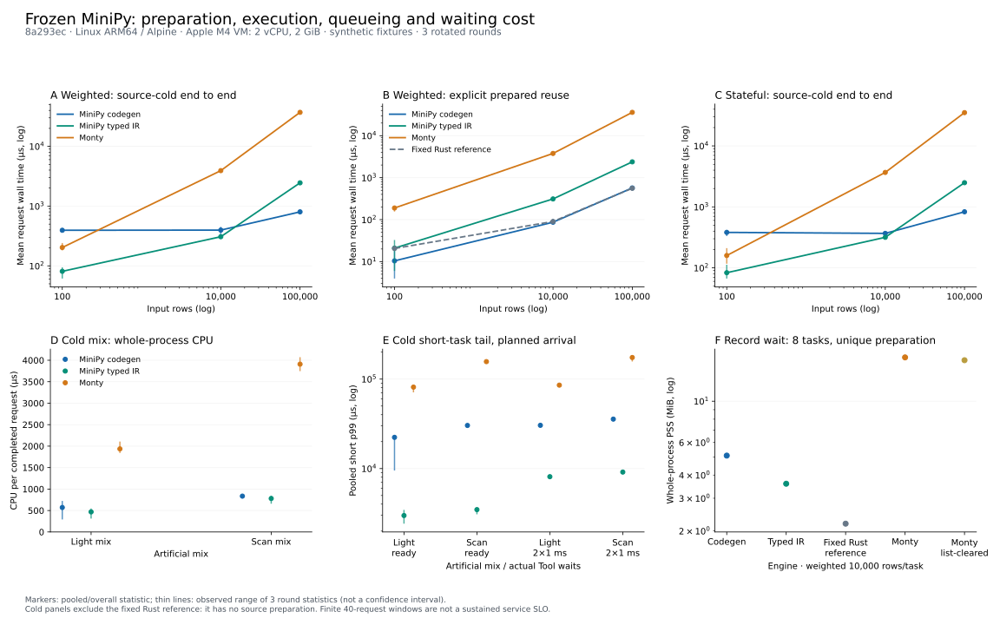
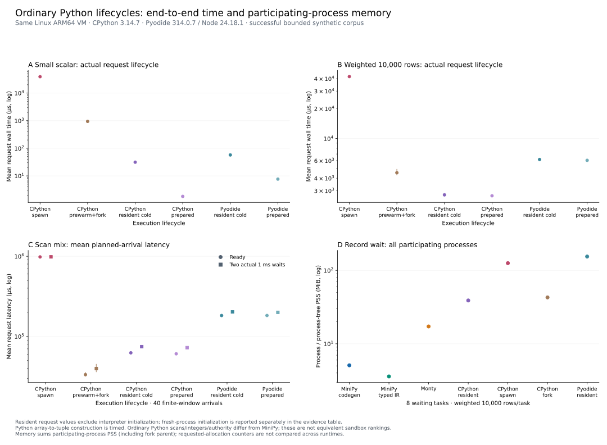

# 端到端成本：源码准备/编译 + 执行

本轮冻结生产源码 `8a293ec54c6e7aed72e23a5c1557a3bdc3b44f60`。全部速度/内存 arm 在同一台实际 Linux ARM64 VM 顺序运行；本轮没有产品优化、自动 backend 选择、源码 cache 或发布 CI。

结论：源码冷的小程序不适合承担 native compilation；明确复用准备代码或扫描较大 typed buffer 时，codegen 更有价值。普通 Python resident 标量很便宜，typed data 路径的价值主要体现在避免对象物化、数据移动和大扫描开销。预热进程、预编译固定程序与未知源码准备属于不同生命周期，不能合成一个“最快语言”排名。

首次四路矩阵、后增 CPython/Pyodide、共同源码和手写汇编各有独立 raw/identity。本轮不从 J/K 或其他机器拼数字，也不据此计算历史优化幅度。

## 图与证据



图中 source-cold 包含源码解析、类型准备/编译、执行、输入构造和回收，但 worker process/Tokio runtime 已驻留。Prepared 是显式 code reuse，每请求仍有新状态和 Provider/input，不是免费初始化。固定 Rust 参考只出现在 prepared panel，没有未知源码准备。



第二张图来自原始适配语料：Monty/CPython/Pyodide 扫描 tuple rows，MiniPy 扫描 Quote/v1。下面的共同源码表是新增 cohort，不把其 timing 与原始 tuple cohort 的内存混称一次运行。

机器入口：[`summary.json`](../bench/results/l-final/summary.json)、[`plan.json`](../bench/results/l-final/plan.json)、[`addon-plan.json`](../bench/results/l-final/addon-plan.json)、[`workload-accounting.json`](../bench/results/l-final/workload-accounting.json)。SVG 有同名 PNG 预览。摘要字段保留 unit、mode、round ranges、缺失值和 overload，适合 demo 消费；图中数值只来自 summary。

## 环境与统计边界

- Apple M4 / Mac16,10、宿主 10 logical CPUs、16 GiB RAM，macOS 26.4.1；guest Alpine Linux 3.24 ARM64、Linux 6.18.52、2 vCPU / 2048 MiB。预/后检查没有 swap 使用；没有单独采样宿主温度、频率或物理核映射。
- Rust 1.96.0、Zig 0.15.2、`aarch64-unknown-linux-musl`，Monty `56949a4c45f51cedc7a96450782f58a8017e114d`。CPython 3.14.7；Pyodide 314.0.7 内部 CPython 3.14.2；task-local Node 24.18.1。Node/依赖只解压到 guest 本任务目录，没有全局安装。
- 全轮未 pin，也未中途改变 affinity。VM 内没有并行跑速度/内存 campaign；计时时暂停重编译。宿主调度/其他桌面负载仍可能干扰。2 vCPU 是受控相对对照，不能当裸机绝对值；guest `taskset` 也不等于物理核独占。
- 三轮按 arm 轮转，奇数轮反向。标注值是请求均值、batch 总 CPU/成功数或 pooled nearest-rank 分位数；方括号/图中细线是三轮统计量的观测 min–max，不是 CI。独立 `n=3`，请求数不是独立 n。
- 原始 shape 101 个请求保留 sample≥21；mixed 9 个窗口保留≥2。共同源码 primary shape 41 个保留≥11，mixed 5 个保留≥1；Python shape 21 个保留≥1。汇编 101 个保留≥21。所有 warmup raw 都保留。
- 速度 binary 不带 allocation diagnostics/trace。内存用独立新 process 和 counting/tracemalloc diagnostics。Rust requested Layout bytes、Python tracemalloc 与整个 runtime allocation 不等价，缺测保持 null；跨 runtime 主图用整个参与 process/process-tree PSS。

## 原始四路：冷总成本与显式复用

下表单位均为 µs，值为总体均值 [三轮均值最小值, 最大值]。`prepare`/`execute` 是直接计时的 wall phase，不是 CPU stage，也不相加 phase medians 构造未测总时间。

| 程序/rows | 执行路径 | cold wall | cold CPU | prepare wall | execute wall | prepared wall |
| --- | --- | --- | --- | --- | --- | --- |
| scalar:0 | MiniPy codegen | 286.37 [281.97, 291.71] | 287.39 [283.01, 292.68] | 277.04 [272.51, 282.47] | 7.72 [7.64, 7.86] | 8.12 [3.11, 12.40] |
| scalar:0 | MiniPy typed IR | 50.70 [40.38, 68.35] | 51.67 [41.48, 69.16] | 42.19 [32.52, 58.27] | 6.58 [5.87, 7.74] | 4.21 [3.56, 4.76] |
| scalar:0 | 普通 Monty | 61.29 [47.18, 69.70] | 62.25 [47.90, 70.69] | 36.28 [27.62, 41.26] | 23.54 [18.23, 27.04] | 36.09 [24.65, 47.22] |
| weighted:10,000 | MiniPy codegen | 396.70 [306.32, 449.14] | 397.33 [306.89, 449.76] | 309.94 [238.31, 354.60] | 85.79 [67.26, 96.63] | 86.86 [76.88, 104.12] |
| weighted:10,000 | MiniPy typed IR | 307.27 [294.54, 315.26] | 307.72 [294.99, 315.71] | 35.43 [34.28, 36.75] | 271.04 [259.49, 277.67] | 311.45 [289.50, 335.94] |
| weighted:10,000 | 普通 Monty | 3923.67 [3869.09, 4023.41] | 3923.95 [3869.66, 4023.38] | 30.67 [28.60, 32.85] | 3892.09 [3837.51, 3989.62] | 3781.33 [3754.68, 3831.82] |
| stateful:100,000 | MiniPy codegen | 830.22 [827.87, 831.81] | 830.77 [828.41, 832.38] | 271.16 [266.88, 277.49] | 558.29 [553.59, 561.10] | 581.93 [578.38, 588.01] |
| stateful:100,000 | MiniPy typed IR | 2491.43 [2447.35, 2560.24] | 2491.66 [2447.29, 2560.65] | 41.03 [38.33, 45.70] | 2449.60 [2407.52, 2513.68] | 2510.66 [2484.56, 2523.96] |
| stateful:100,000 | 普通 Monty | 35166.75 [34925.68, 35637.50] | 35166.14 [34925.84, 35639.24] | 47.53 [43.39, 49.91] | 35118.30 [34875.46, 35586.65] | 34660.56 [34579.41, 34776.27] |

Native 在小标量中承担明显 compilation 成本。主矩阵 light/scan 的平均 cold CPU，typed IR 通常较少；native/IR 的小幅平均 CPU 差距有 round variability，不能只取一个比例。Prepared native 在含大扫描的混合中明显减少 CPU，而 source-cold compilation 会阻塞同一 dispatcher 上其他任务的计划到达。

### finite-window 混合、容量与 overload

Light 权重 `(scalar0, weighted100, stateful100, weighted10k, stateful100k)=(24,8,4,2,2)`；scan 为 `(8,16,8,4,4)`。每窗口 40 个计划到达，间隔 500 µs，名义窗口 100 ms。latency 从计划到达开始，含到达/编译/admission 排队；完成后等到窗口结束，超时窗口先 drain 再开始下一窗口。没有持续推进固定到达时钟，因此不能当持续 400 requests/s 生产 SLO。

`2×1ms` 是两次实际 Tokio/asyncio timer await 的请求参数，不保证实际总 wait 精确 2ms，不是网络/数据库实测。短任务是 rows≤100 的固定人工组合；scalar 不调用 Tool。以下为 source-cold，CPU/请求、平均 latency、短 p50/p95/p99 均为 µs。

| mix | Tool delay µs | 路径 | CPU/成功数 | mean latency | short p50 | short p95 | short p99 | overload windows | finite requests/s |
| --- | --- | --- | --- | --- | --- | --- | --- | --- | --- |
| light | 0 | MiniPy typed IR | 467.52 [312.25, 546.83] | 1802.30 | 838.52 | 1909.66 | 2985.55 | 0/21 | 400.0 |
| light | 1000 | MiniPy typed IR | 558.68 [549.94, 566.44] | 3695.25 | 1179.91 | 6901.99 | 8113.22 | 0/21 | 400.0 |
| scan | 0 | MiniPy typed IR | 779.43 [659.10, 846.18] | 3824.71 | 968.40 | 2510.65 | 3474.38 | 0/21 | 400.0 |
| scan | 1000 | MiniPy typed IR | 813.44 [737.52, 860.91] | 7735.21 | 5044.04 | 8281.05 | 9141.85 | 0/21 | 400.0 |
| light | 0 | 普通 Monty | 1935.50 [1839.38, 2105.91] | 38467.61 | 28875.28 | 74859.11 | 81394.25 | 0/21 | 400.0 |
| light | 1000 | 普通 Monty | 2025.48 [1941.12, 2146.42] | 39887.79 | 29476.20 | 81834.11 | 85652.19 | 0/21 | 400.0 |
| scan | 0 | 普通 Monty | 3908.97 [3747.44, 4071.28] | 100345.95 | 131751.23 | 153446.55 | 156869.09 | 21/21 | 252.7 |
| scan | 1000 | 普通 Monty | 3905.39 [3859.53, 3948.88] | 109382.81 | 138088.55 | 168469.92 | 174480.73 | 21/21 | 248.3 |
| light | 0 | MiniPy codegen | 570.31 [292.17, 723.60] | 8026.01 | 6962.83 | 19813.59 | 22341.78 | 0/21 | 400.0 |
| light | 1000 | MiniPy codegen | 736.52 [709.16, 752.08] | 13564.88 | 9972.21 | 27926.59 | 30448.90 | 0/21 | 400.0 |
| scan | 0 | MiniPy codegen | 835.21 [781.80, 872.27] | 18384.47 | 17171.46 | 27836.62 | 30343.39 | 0/21 | 400.0 |
| scan | 1000 | MiniPy codegen | 891.56 [877.94, 917.47] | 23195.26 | 23086.85 | 33819.51 | 35723.91 | 0/21 | 400.0 |

容量 probe 固定 scan/source-cold/两次 1ms await，改变 admitted inflight=1/8/32，源/到达计划不改。排队在 latency 中，所有请求完成；这里不是最大可承载并发搜索。

| 路径 | inflight | mean latency µs | short p99 µs | overload windows | finite requests/s |
| --- | --- | --- | --- | --- | --- |
| MiniPy typed IR | 1 | 104754.54 | 202436.10 | 21/21 | 183.8 |
| MiniPy typed IR | 8 | 9522.30 | 14098.90 | 0/21 | 400.0 |
| MiniPy typed IR | 32 | 7888.31 | 9080.38 | 0/21 | 400.0 |
| 普通 Monty | 1 | 154852.37 | 290814.65 | 21/21 | 133.1 |
| 普通 Monty | 8 | 244046.78 | 393920.28 | 21/21 | 124.4 |
| 普通 Monty | 32 | 111433.09 | 174882.61 | 21/21 | 244.4 |
| MiniPy codegen | 1 | 95482.10 | 184383.64 | 21/21 | 200.3 |
| MiniPy codegen | 8 | 21495.28 | 35180.62 | 0/21 | 400.0 |
| MiniPy codegen | 32 | 18169.63 | 34620.90 | 0/21 | 400.0 |
| 固定 Rust 程序参考 | 1 | 79709.32 | 155433.91 | 21/21 | 231.3 |
| 固定 Rust 程序参考 | 8 | 5807.82 | 9491.76 | 0/21 | 400.0 |
| 固定 Rust 程序参考 | 32 | 5362.29 | 8781.42 | 0/21 | 400.0 |

### 小 warm 的一次有据补测

初次 warm 标量的 codegen round 均值在 3.11–12.40µs，明显不稳定。按预登记 probe，用原始冻结 speed binary 做 3 轮 × 1001 请求、保留≥201；不替换主矩阵或和它合并。较长 sample run 的工作条件不同，不能用它计算主矩阵优化倍数。

| 路径 | 单独复测 warm wall µs |
| --- | --- |
| MiniPy codegen | 2.03 [1.89, 2.23] |
| MiniPy typed IR | 1.86 [1.83, 1.89] |
| 普通 Monty | 10.93 [10.75, 11.30] |
| 固定 Rust 程序参考 | 1.78 [1.76, 1.79] |

补测支持“小程序 steady-state 本身很便宜”；native/IR 的细微标量排序受运行长度、scheduler、timer/CPU accounting overhead 影响，不以此选一个通用 backend。

## 实际 work，不只看 row count

这些逻辑计数由相同生成输入离线逐行复算，没有向速度 hot path 加计数器。它们是 source-level 分支/算术工作量，不是硬件分支或 CPU utilization 测量。`stateful:100k` 是大扫描、主要执行 predicates，不称其为高算术强度 workload；输入构造、对象物化和 predicate 仍有成本。

| 程序 | rows | quantity>0 | 再通过 price | 最终选中 | 选中比例 | accumulator mul | accumulator add | previous 更新 |
| --- | --- | --- | --- | --- | --- | --- | --- | --- |
| weighted | 10000 | 6666 | 4650 | 4650 | 46.500% | 4650 | 4650 | 0 |
| weighted | 100000 | 66666 | 46710 | 46710 | 46.710% | 46710 | 46710 | 0 |
| stateful | 10000 | 6666 | 4650 | 18 | 0.180% | 18 | 18 | 18 |
| stateful | 100000 | 66666 | 46710 | 78 | 0.078% | 78 | 78 | 78 |

## 新增真正共同源码主体

可展示程序是 [`common_scalar.py`](../fixtures/common_scalar.py)、[`common_weighted.py`](../fixtures/common_weighted.py)、[`common_stateful.py`](../fixtures/common_stateful.py)。MiniPy 与 Monty 直接读取逐字相同 UTF-8 body；两者都支持这里的 top-level await。CPython/Pyodide 的整个 source 多一个 async function signature 和四格缩进，显式记录于 `common-cpython-identity.json.wrappers`；去缩进逐字还原 body 的断言和测试通过。未改 Tool 名、属性访问、算法、谓词顺序或算术表达式。

适配在 Host：MiniPy 是 immutable Quote/v1；Monty 是 `tools` module + eager HostClass Quote fields；CPython/Pyodide 是 signed-64 packed array 转 Quote namedtuple list。每请求 Provider、数据生成/转换、输出与回收在计时内；函数 wrapper 构造/compile 在 fresh-source timing 内，prepared mode 明确复用其 code。来源配置/benchmark 选择和 IPC outside-boundary 明确不同：resident 单请求没有 fake child process/IPC，spawn/fork 含真实 IPC/teardown。

初次 Monty namedtuple adapter 的 Tools 属性访问在固定 revision 上失败，未进入正式 common raw；改为其已存在的 eager HostClass/module 接口。失败 identity 保留。

以下为共同主体的实际 lifecycle wall µs，不把三种输入 ABI 当相同内部操作，也不把其结果解释为纯编译器/纯整数算术排名。共同主体没有新增 waiting-memory cohort，原始 tuple cohort 的 PSS 不迁移到这张表。

| 路径 | source lifecycle | scalar0 wall | weighted10k wall | stateful100k wall |
| --- | --- | --- | --- | --- |
| MiniPy codegen | cold | 226.92 [156.05, 278.93] | 452.93 [367.28, 500.09] | 903.35 [850.75, 965.86] |
| MiniPy typed IR | cold | 47.19 [35.92, 53.86] | 388.04 [343.73, 422.83] | 2456.20 [2414.83, 2481.78] |
| 普通 Monty | cold | 87.87 [43.94, 113.23] | 11969.06 [11827.34, 12051.74] | 121227.48 [119385.95, 123080.34] |
| CPython resident / fresh source | cold | 30.33 [27.99, 34.27] | 3973.20 [3882.55, 4035.66] | 33948.65 [33829.02, 34080.86] |
| CPython resident / prepared source | warm | 1.95 [1.93, 1.98] | 3935.65 [3904.54, 3985.99] | 33809.49 [33697.67, 33981.10] |
| Pyodide resident / fresh source | cold | 62.75 [61.43, 64.49] | 9712.08 [9641.82, 9747.74] | 91744.41 [91165.14, 92217.47] |
| Pyodide resident / prepared source | warm | 8.12 [7.89, 8.58] | 9619.04 [9527.75, 9676.33] | 91503.80 [90846.24, 91872.93] |

CPython/Pyodide 的转换分项直接覆盖 packed input 生成及 Quote object construction，均为 wall µs：

| 路径 | 程序 | input generation + conversion wall | whole request wall |
| --- | --- | --- | --- |
| CPython resident / fresh source | weighted:10000 | 3395.51 [3317.28, 3440.76] | 3973.20 [3882.55, 4035.66] |
| CPython resident / fresh source | stateful:100000 | 29793.79 [29672.06, 29917.14] | 33948.65 [33829.02, 34080.86] |
| Pyodide resident / fresh source | weighted:10000 | 7751.85 [7733.43, 7764.73] | 9712.08 [9641.82, 9747.74] |
| Pyodide resident / fresh source | stateful:100000 | 77010.07 [76798.11, 77218.78] | 91744.41 [91165.14, 92217.47] |

共同主体 scan mix 的 ready 路径（每个路径使用表中标明的 source lifecycle），CPU/请求、平均 planned-arrival latency 与 short p99 为 µs：

| 路径 | source lifecycle | CPU/成功数 | mean latency | short p99 | overload windows |
| --- | --- | --- | --- | --- | --- |
| MiniPy typed IR | mixed-cold | 576.79 [456.79, 654.61] | 2516.61 | 2783.99 | 0/12 |
| MiniPy typed IR | mixed-warm | 526.32 [420.43, 584.03] | 2093.03 | 1947.77 | 0/12 |
| 普通 Monty | mixed-cold | 12489.51 [12434.90, 12589.68] | 327762.18 | 490688.46 | 12/12 |
| 普通 Monty | mixed-warm | 12651.61 [12478.37, 12919.58] | 321986.31 | 503007.73 | 12/12 |
| MiniPy codegen | mixed-cold | 621.06 [574.84, 680.77] | 9914.05 | 18295.88 | 0/12 |
| MiniPy codegen | mixed-warm | 219.75 [187.65, 239.06] | 1268.82 | 2670.66 | 0/12 |
| CPython resident / prepared source | warm | 3975.19 [3953.68, 4009.61] | 96970.50 | 155101.31 | 12/12 |
| CPython resident / fresh source | cold | 4024.25 [3961.74, 4111.87] | 100440.61 | 156016.78 | 12/12 |
| Pyodide resident / prepared source | warm | 10176.42 [10056.48, 10326.09] | 281054.69 | 401601.76 | 12/12 |
| Pyodide resident / fresh source | cold | 10339.08 [10272.48, 10377.53] | 281262.28 | 407890.67 | 12/12 |

### 整数、authority、取消的边界

相同主体和有效输入只证明这些正常结果/调用顺序相同。生成数据 price 0–999、quantity -2–6、limit700、batch17，所有选中 arithmetic 及 receipt 都在 i64 范围。MiniPy/汇编保留 signed-64 中间溢出、row/byte/Tool/print 预算和 chunk/cancel 行为；普通 Monty/Python 有任意精度整数，扫描是不同的 blocking turn，没有同一套 fuel/capability 机制。Python 的异步操作取消也不是 MiniPy 的 detached operation lifetime。CPython spawn/fork 的进程隔离不是相同语言 authority；Pyodide Node resident 不是浏览器隔离测试。本轮不评判任意恶意/错误程序的 sandbox 强度。

## 手写 AArch64 汇编性能参考

源为 [`weighted_aarch64.S`](../bench/src/weighted_aarch64.S)，受控 Host 是 [`assembly_reference.rs`](../bench/src/assembly_reference.rs)，可执行 harness 是 [`assembly_ab.rs`](../bench/src/bin/assembly_ab.rs)。实际手写 AAPCS64 指令：`mul` + `smulh` 检查 signed product，`adds` + V flag 检查 sum，保留 quantity/price/previous 的短路顺序。入口只接有效 immutable slice 和独立 i64 state pointers，没有任意用户机器码注入。

V1 的不变 mode 分支位于 row loop 内，108B；仅做一次外提，最终 checked kernel 的 code bytes 是 160B，numeric sum/previous state 16B。这些不是 Task future/服务总内存。没有 unchecked 或 SIMD 假设版本。代码更短/手写不保证最快，weighted 的最终 kernel 与同轮优化 Rust 大致相当；stateful 仍较慢。V1 raw/source 与 V2 结果都保留，非配对的 V1→V2 不计算因果加速比例。

Kernel-only：input 创建/验证在计时外，计时内含 checked 256-row kernel calls + numeric state 初始化，无 Provider、stdout、async waits、未知源码准备。Full：实际相同 RequestProvider/Quote/v1，数据构造在每请求 timing 内，row/byte/Tool/print bounds、chunk yield、detached load/record/cancel、输出和回收均保留。Host 因生产 helper 为 crate-private，benchmark 中复制相同 cancellation/authority 机制；单行输出使用 format!，其额外 allocation 已计时。它是固定程序执行参考，不是通用编译 baseline 或已证明物理最优。

发现初次 full harness 还在 timing 外保留了无用预验证 fixture（实际 Provider 已在 timing 内生成另一个 input）。已去掉；最终 full table 使用 `assembly-full.jsonl.gz` 的新 3 轮配对数据，原 full raw 仅作历史诊断。Kernel-only 使用独立有效的 `assembly-v2.jsonl.gz`；表格不把两种 boundary 合成一个 e2e time。

单位 µs，均值 [三轮均值范围]，100,000 rows：

| 程序 | 固定程序 arm | boundary | Tool delay µs | wall | CPU |
| --- | --- | --- | --- | --- | --- |
| stateful | assembly | full | 0 | 579.61 [542.18, 631.94] | 580.14 [542.65, 632.42] |
| stateful | assembly | full | 1000 | 6080.84 [4886.67, 6900.97] | 1525.50 [591.05, 2194.69] |
| weighted | assembly | full | 0 | 567.99 [514.44, 603.46] | 568.52 [514.90, 604.08] |
| weighted | assembly | full | 1000 | 5144.46 [4855.27, 5482.26] | 718.72 [558.35, 1028.72] |
| stateful | assembly | kernel | 0 | 195.59 [183.54, 217.24] | 196.53 [184.55, 218.22] |
| weighted | assembly | kernel | 0 | 144.73 [129.27, 159.06] | 145.80 [129.69, 160.84] |
| stateful | rust | full | 0 | 548.55 [511.40, 604.98] | 549.02 [511.81, 605.55] |
| stateful | rust | full | 1000 | 6016.33 [5426.96, 6739.31] | 1324.55 [555.64, 2094.86] |
| weighted | rust | full | 0 | 607.45 [522.42, 653.56] | 607.94 [522.96, 654.01] |
| weighted | rust | full | 1000 | 5613.87 [4850.64, 7009.67] | 1180.71 [579.54, 2288.34] |
| stateful | rust | kernel | 0 | 133.04 [109.94, 147.25] | 134.28 [110.90, 148.59] |
| weighted | rust | kernel | 0 | 146.29 [135.69, 155.69] | 147.35 [136.66, 156.51] |

## Waiting memory 与 density（独立问题）

原始四路测 1/8/32 tasks、10k rows/task、unique/shared preparation；shared 意味 prepare-once + backend 自己的 duplicate 行为，Monty clone 不承诺全部 object memory 物理共享。每个 cell 是独立新 process，重复三次。Gate 观察 load wait、record wait、reclaimed；requested allocator bytes 与整个 process RSS/PSS 都在 raw，以下只列 8 tasks / unique 的 PSS（MiB）。Spawn/fork 包含 controller + 全部 living workers；PSS 求和分摊共享页，RSS 不作为物理总量相加。Node/Pyodide Provider 与 dispatcher 在同一参与进程。

这些是等待态 footprint，未搜索生产容量上限，也不据之直接推算每 GiB 最大用户数。Node/V8/WASM、scheduler、代码、Provider、data、输出/诊断状态均在 participating-process PSS 范围内；WASM tracing bytes 不是整个 V8 footprint。

| 路径 / original adapted cohort | startup PSS | load wait PSS | record wait PSS | reclaimed PSS |
| --- | --- | --- | --- | --- |
| MiniPy codegen | 1.66 | 6.34 | 5.09 | 4.98 |
| MiniPy typed IR | 1.66 | 4.84 | 3.59 | 3.56 |
| 固定 Rust 程序参考 | 1.66 | 3.31 | 2.19 | 2.17 |
| 普通 Monty | 1.66 | 6.94 | 17.23 | 6.31 |
| CPython resident / fresh source | 15.73 | 17.17 | 38.92 | 20.31 |
| CPython 每请求 spawn | 15.02 | 119.38 | 125.43 | 15.11 |
| CPython 预热后 fork | 15.05 | 36.12 | 42.84 | 15.11 |
| Pyodide resident / fresh source | 145.92 | 147.34 | 154.36 | 154.28 |

固定汇编 Host 的独立 memory process footprint（10k rows/task，static shared code；不可把其 minimal binary base 当同一通用 compiler service）：

| phase / 8 tasks | whole-process PSS MiB | Rust whole-process requested bytes |
| --- | --- | --- |
| load_wait | 2.052 | 1304187 |
| reclaimed | 0.786 | 11707 |
| record_wait | 0.802 | 24125 |
| startup | 0.779 | 10425 |

Native/IR 在已证明最后使用处释放 typed payload，后续 print 仍可要求保留 code/frame；普通 tuple/object corpus 的局部引用有不同 lifetime。Monty list-cleared 只作显式 fixture-specific 强参考，其 PSS 与 allocator reclaim 不必同一时间下降。Owner release、取消 suspended receiver、late provider completion 和 effect errors 另用真实 gate 生命周期测试验证，不用 frame bytes 替代服务内存。

## 新 process 初始化单列

下面是 in-VM controller 直接测完整新 process 生命周期，不含 SSH 往返。CPython 行包含新 interpreter/imports、source-cold scalar 请求、真实 IPC 和 reap；Node/Pyodide 行包含 Node/imports、WASM/stdlib/harness 初始化和退出，内部 init timer 也在该次 response 中。使用 current common-capable harness；不把这些值事后摊入旧 resident observations。单位 ms，三次独立新进程的均值 [观察范围]。

| 完整 process boundary | wall ms | total controller+child CPU ms |
| --- | --- | --- |
| cpython | 40.49 [39.86, 41.12] | 40.59 [39.94, 41.24] |
| pyodide | 1115.94 [1106.95, 1125.40] | 1480.64 [1477.16, 1486.58] |

## 覆盖、验证与限制

主四路 60,696 请求全部成功，108/108 speed cells、120/120 memory cells。新增 CPython 10,860、Pyodide 5,430 请求；共同主体 25,350 请求、84/84 cells；最终 fixed reference 40/40 cells（12,120 observations，kernel/full 来自明确不同 cohort）。一次 warm 长复测 12,012 行。历史汇编 V1/V2/full 修正前数据都保留，不混入 final full 表。正式数据无 timeout/failed request；部署 fixture 缺失与 namedtuple adapter smoke 失败有独立 identity，不能把 operational attempts 宣称零失败。

已实际运行：Linux AArch64 汇编 differential MIN/MAX/overflow/filter-order/chunk tests 与 whole Host permission/budget/cancel/late-completion tests；完整 assembly test binary 4/4。冻结 native/IR/reference lifecycle 在 macOS 与实际 Linux 均通过。Python reduction/common-wrapper 五个针对性测试通过。summary 可从 raw 复算；独立复算与最终聚焦 evidence/figure review 的记录随本轮交付。真实 PNG 已打开检查文字、图例、裁切和范围编码。

未测：浏览器 Pyodide、长期持续 open-loop SLO、NUMA/裸机 affinity、多核 capacity search、任意恶意 Python sandbox、安全等级等价、byte/string 输入微增量、common-body waiting-memory。未来裸机对照应固定同一 NUMA 物理核集合、避开 SMT siblings、记录 CPU/温度/频率和无 swap 压力，所有 paired arms 使用同一 affinity，不把本 VM 与未来机器混合排序。

本轮剩余热点主要是 cold native compilation、typed IR 的逐行 predicate/expression execution，以及普通对象 runtime 的数据构造/桥接和 blocking scans。规模本身不是算术强度指标。没有自动 cache/backend heuristics 提案，也没有从当前单机 synthetic mix 推导真实部署占比。

## 复现（不需要 CI、Docker 或全局安装）

分析/出图：

```sh
python3 tools/final_workload.py
python3 tools/final_summary.py
python3 -m unittest discover -s tools -p test_final_benchmark.py -v
uv run --with matplotlib python tools/final_plot.py
python3 tools/final_report.py
```

原始四路的 measured harness 已保存为 `bench/results/l-final/sources/interpreter_ab-primary.rs`，其 SHA 与原 identity 精确核对；`sources/final_python.py` / `final_pyodide.mjs` 是原 secondary cohort 的精确 source snapshot。新 common/最终汇编使用当前 tools/bench sources。不同历史 cohort 的 harness 不被当前 adapter silently 覆盖。

在干净的 frozen-source reproduction checkout 将 primary snapshot 放回 `bench/src/bin/interpreter_ab.rs`（不要覆盖在用的主 checkout），沿 `identity.json` 的 source/toolchain 和以下命令构建。新 campaign 应使用新 result 目录，runner 默认拒绝覆盖 raw：

```sh
cargo +1.96.0 zigbuild --release --locked --manifest-path bench/Cargo.toml --target aarch64-unknown-linux-musl --bin interpreter_ab
# 保存 speed；再单独构建 memory：
cargo +1.96.0 zigbuild --release --locked --manifest-path bench/Cargo.toml --target aarch64-unknown-linux-musl --bin interpreter_ab --features allocation-diagnostics
python3 tools/final_campaign.py HOST KEY KNOWN SPEED MEMORY
# 当前共同源码：同样 build interpreter_ab speed binary，开启 MINIPY_COMMON=1。
# 完整原 secondary 用 sources/ 下两个 sibling snapshots，Node package 对应 314.0.7。
python3 tools/final_secondary.py HOST KEY KNOWN
# 当前 common + 原始汇编追加的命令逐项保存在 addon-identity.json。
python3 tools/final_addon.py HOST KEY KNOWN COMMON_SPEED ASM_SPEED ASM_MEMORY ASM_TEST
# 最终 checked kernel/Host（先保存 speed；memory 独立 --features allocation-diagnostics）：
cargo +1.96.0 zigbuild --release --locked --manifest-path bench/Cargo.toml --target aarch64-unknown-linux-musl --bin assembly_ab
cargo +1.96.0 zigbuild --release --locked --manifest-path bench/Cargo.toml --target aarch64-unknown-linux-musl --bin assembly_ab --tests
python3 tools/final_assembly_refinement.py HOST KEY KNOWN SPEED MEMORY TEST full-only
# 单个可展示的 full reference / kernel（预编译固定程序）：
# 在 Linux ARM64：assembly_ab assembly full weighted 100000 101 1000
#             assembly_ab assembly kernel weighted 100000 101 0
```

Node/Pyodide task-local建立的逐项命令在 `secondary-identity.json`，APK HTTP download failure 后改用 HTTPS，未改系统 package/config。guest package tarballs、编译树与大可再生 artifacts 不提交。生产库、dependency lock 与 threat model 未改；VM 恢复初始 off 状态的验证在环境/交付记录中。
