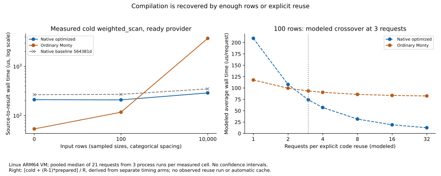
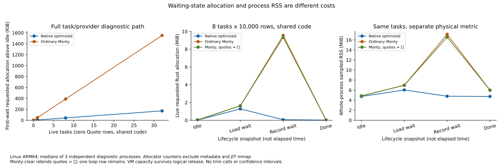
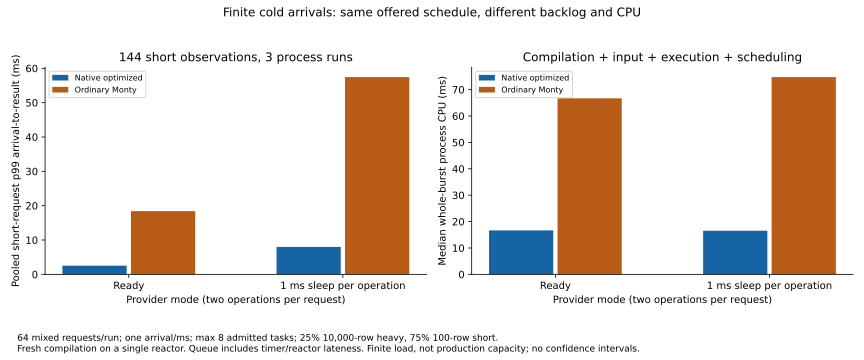

# Integrated cost and density evidence

## Result and decision

Keep opt-in compiler diagnostics. The native path still pays substantially more
compilation than ordinary Monty for source-once tiny inputs, but avoids per-row
objects on the 10,000-row cases and uses less waiting-state memory in this bounded
Quote/v1 path. No automatic code cache, owner representation change, runtime
framework or language expansion was added. The owner candidate remains unmerged.

The additional cold-arrival control includes source/compile and backlog. The
ordinary Monty explicit-list-clear control reduces logical retention but retains
most measured VM allocation/capacity. These controls support further investigation
of native compilation and data representation rather than a universal speed claim.

## Evidence boundary and reproduction

- Runtime baseline: `564381d304be69d1fd870d4e92530c8024b7c394`.
- Integrated measured source/harness: `065c7cbff5dc348437c520525b4882dfa07aca4e`.
  Both runtime arms use exactly that benchmark crate and its locked dependencies.
  The deployment runner verifies the identical relevant source/manifest bytes.
- Monty: `56949a4c45f51cedc7a96450782f58a8017e114d`; ordinary user logic,
  not a handwritten fixture kernel. Earlier finite typed helpers remain a separate
  reference in [experiments](experiments.md), not the main ranking here.
- Actual execution: existing Linux ARM64 VM on Apple M4, two virtual CPUs,
  2 GiB configured memory; Linux 6.18.52 Alpine. Single current-thread reactor.
  Preflight: load 0.00/0.01/0.00, 1,761 MiB available, 12.8 GiB free, swap unused.
- Build: Rust 1.96.0, Zig 0.15.2, `aarch64-unknown-linux-musl`, locked release.
  Speed binary uses System with no allocation diagnostics or trace. Memory uses
  a separate counting-allocator binary. The actual VM test log is committed.
- Formal campaign: 39 cells x 2 runtime arms x 3 serial process repetitions =
  234 completed commands, no failed/skipped/timed-out cell. Arms alternate by
  round. 7 retained latency samples per cell/process after 2 warm-ups, giving
  21 observations and 3 independent processes. Cold means fresh source compilation
  in an initialized process, not executable launch or empty filesystem cache.
- Raw: [v2-raw.jsonl](../bench/results/c-linux-v2/v2-raw.jsonl) (7,711 rows).
  [Commands/status](../bench/results/c-linux-v2/v2-runs.jsonl),
  [derived summary](../bench/results/c-linux-v2/v2-summary.json),
  [host/build/deployment](../bench/results/c-linux-v2/build-identity.json),
  [verification](../bench/results/c-linux-v2/verification.json).
  All 1,008 latency and 5,472 request receipts were independently recomputed in
  Python with batch=17, limit=700. Every request ID and queue+service=latency is
  checked. Request count is not the number of independent repetitions.

From the measured source on a clean checkout (build trees are ignored):

```sh
python3 tools/prepare_bench_v2_baseline.py 065c7cb
cargo +1.96.0 zigbuild --release --locked --manifest-path bench/Cargo.toml --target aarch64-unknown-linux-musl --bin bench-v2 --bin memory-v2
cargo +1.96.0 zigbuild --release --locked --manifest-path bench/target/c-baseline-source/bench/Cargo.toml --target aarch64-unknown-linux-musl --bin bench-v2 --bin memory-v2
python3 tools/run_c_linux_v2.py HOST SSH_KEY KNOWN_HOSTS
python3 tools/verify_c_bench_v2.py
python3 tools/summarize_bench_v2.py bench/results/c-linux-v2
uv run --with matplotlib python tools/plot_bench_v2.py
```

The actual baseline setup began at 13636a1; the two HWM-reader revisions were
copied into its generated bench/src/v2_common.rs before rebuilding both arms.
No baseline runtime source was changed. The clean-checkout commands above produce
that same final source layout. Guest builds/installs, CI, Docker and global system
changes were not used. The runner guest has no git/rustup: null identity fields
mean unavailable guest tools; host build identity supplies provenance.

## Source once and explicit preparation

Pooled median wall microseconds. Source read, compilation or clone, fresh input
production/import, dispatch, scan, waits and request cleanup are included. The
prepared code owner's compilation/lifetime is outside the prepared request timer.

| Program | Rows | Native baseline cold | Native integrated cold | Ordinary Monty cold | Native prepared | Monty prepared |
|---|---:|---:|---:|---:|---:|---:|
| weighted_scan | 0 | 267.00 | 211.33 | 53.79 | 4.04 | 19.12 |
| weighted_scan | 100 | 270.21 | 209.29 | 117.63 | 6.25 | 81.38 |
| weighted_scan | 10,000 | 350.17 | 289.50 | 3712.72 | 88.54 | 3898.14 |
| stateful_branch | 0 | 344.08 | 283.67 | 55.04 | 3.71 | 16.38 |
| stateful_branch | 100 | 347.42 | 291.00 | 118.38 | 6.50 | 80.54 |
| stateful_branch | 10,000 | 440.71 | 382.92 | 3985.06 | 93.50 | 3869.18 |

Removing CLIF formatting/retention and pass timing cuts weighted cold totals by
20.8% at zero rows and 17.3% at 10,000 rows; stateful 10,000 rows improves
13.1%. Warm differences are small and are not claimed as a runtime improvement.
Weighted 10,000-row compile attribution is 198.33 us; stateful is
286.17 us. Attribution-column medians do not sum to a measured total.
Emitted code stays 192 bytes weighted and 292 bytes stateful, not total code pages
or compiler footprint. At 100 rows native remains slower source-once than Monty.

Modeled minimum requests to recover compilation under explicit code reuse:

| Program | 0 rows | 100 rows | 10,000 rows |
|---|---:|---:|---:|
| weighted_scan | 12 | 3 | 1 |
| stateful_branch | 20 | 4 | 1 |

Model: `cold + (R-1)*prepared`, using separately measured median timing arms.
This is a sensitivity model, not an observed compile-once batch or a cache-hit
forecast. It assumes immutable code can be explicitly reused. Fresh source-once
requests still pay the cold value. The earlier parameterized helper beats native
cold on its supported weighted primitive; that prior result is not reversed by
this ordinary-Monty comparison. Stateful cross-row logic is unsupported by it.



## Waiting-state and physical memory

All task payloads are independently owned. No Weak observer retains an Arc
allocation. Immutable input lease, task frame and final code use follow production
runtime rules. The shared prepared owner is intentionally retained by the probe.
Neither requested Rust layouts nor source/code bytes are RSS.

For zero Quote rows, a linear diagnostic fit across 0/1/8/32 shared-code tasks
above each process's engine-idle state gives about 5,489 requested bytes/task
native versus 49,676 Monty at first wait (3 processes/point). This includes task,
provider, operation and diagnostic collection overhead. Sampled RSS/PSS is
page-quantized and has a large first-task fixed effect for Monty, so its fitted
slope is not an exact task struct size or a service-density guarantee. Process
base RSS is about 1.71 MiB; code-initialized idle is about 4.74 MiB native and
4.85 MiB Monty in the combined diagnostic executable, not separate production
binary footprints.

8 tasks x 10,000 rows, shared code; medians of 3 diagnostic processes.

| Engine | Phase | Live requested bytes | Sampled RSS MiB | PSS MiB | Observed HWM MiB | Logical Quote bytes |
|---|---|---:|---:|---:|---:|---:|
| native | engine_idle | 16,754 | 4.738 | 4.730 | 4.836 | 0 |
| native | first_wait | 1,340,722 | 6.035 | 6.027 | 6.129 | 1,280,000 |
| native | second_wait | 60,786 | 4.789 | 4.781 | 6.129 | 0 |
| native | completed | 17,522 | 4.738 | 4.730 | 6.129 | 0 |
| monty | engine_idle | 27,870 | 4.852 | 4.844 | 4.852 | 0 |
| monty | first_wait | 1,705,334 | 6.965 | 6.957 | 7.027 | 1,280,000 |
| monty | second_wait | 10,015,990 | 17.129 | 17.121 | 25.527 | 1,280,000 |
| monty | completed | 28,446 | 5.988 | 5.980 | 25.527 | 0 |
| monty-clear | engine_idle | 28,200 | 4.852 | 4.844 | 4.852 | 0 |
| monty-clear | first_wait | 1,706,216 | 6.973 | 6.965 | 7.035 | 1,280,000 |
| monty-clear | second_wait | 9,785,192 | 16.551 | 16.543 | 25.535 | 128 |
| monty-clear | completed | 28,776 | 5.988 | 5.980 | 25.535 | 0 |

Monty `del quotes` is rejected by the pinned parser. The explicit source control
uses `quotes = []`, with the same result/record effect. It drops the list but
retains the final loop variable (16 logical bytes/task). At second wait requested
allocation falls only about 2.3% versus original Monty and RSS by about 3.4%.
VM arena/capacity remains allocated; logical deletion does not imply physical
release. Native has dropped the full row allocation, while its detached provider
and task infrastructure remain. On completion RSS recedes to about 4.74 MiB
native and 5.99 MiB Monty; no allocator trim is invoked.

Shared/unique code controls and cancelled-pending/late-completion phases are in
the raw/summary. Native unique first-wait requested bytes are about 40.8 KiB
higher for these 8 independently compiled instances, with roughly 92 KiB extra
RSS. This is total probe overhead, not just emitted code. Monty's clones share
program Arcs; unique compiles do not show a reliable higher cost at this scale.
Pending cancellation still retains 1,280,000 logical payload bytes on both arms
until detached load completion; a cancelled task is not a completed provider.
Late completion reclaims that payload, without reviving the task or dispatching
record. Weak-only retention behavior in B is excluded from these density probes.

Linux observed HWM is the cumulative max of sampled smaps RSS and reported
VmHWM. Raw kernel readings are retained independently. This captures more than
one snapshot but is not a continuous trace or exact worst-case peak. Allocator
counters separately report transient requested-layout peaks. Physical readers,
JSON and allocator state perturb later samples; memory diagnostics are not the
speed path. macOS smoke has no PSS and is not mixed into Linux statistics.



### 10-byte storage control

At first wait, the native raw Vec control's requested-layout model is
`24 + payload_bytes` per retained item: 34 requested bytes for 10 logical bytes.
Monty's suspended bytes-program diagnostic is `41,799 + payload_bytes` per task
above engine idle. Both observed per-payload-byte slopes are 1 over 0/10/4096
bytes. These are unequal lifecycle paths: the native control has no compiler,
language value, async task or provider; Monty has a full VM suspension. They
isolate representation/storage overhead, not a runtime ranking or a 10B language
string result. RSS at this tiny size changes only by page granularity. The
Quote task slope above is the aligned full-task comparison.

## Finite load: preparation, arrivals and real asynchronous sleeps

`concurrent` is a prepared finite burst, all requests enqueued immediately,
limited by a semaphore. It excludes compilation. The cold control offers 64
requests at absolute 1 ms intervals, with eight admitted tasks and fresh source
compilation inside service. 25% have 10,000 rows, 75% have 100. Scheduled arrival
to completion includes timer lateness, queue, compile and input work. No parallel
compiler pool exists: compilation can delay the single reactor. Timers have
millisecond resolution; these are real Tokio suspension/wakeup operations,
not network or database traces. Source-once fixed-arrival throughput includes
the finite arrival window and drain, so it cannot be called service capacity.

Cold-arrival medians over 3 process runs; short p99 pools 144 observations.
Percentiles of queue and service separately need not sum to latency p99.

| Engine | Delay us/op | Observed requests/s | Short p99 ms | Short queue p99 ms | Whole-run CPU ms | Whole-run wall ms |
|---|---:|---:|---:|---:|---:|---:|
| native | 0 | 988.0 | 2.520 | 1.855 | 16.660 | 64.777 |
| native | 1000 | 928.5 | 7.983 | 1.891 | 16.528 | 68.928 |
| monty | 0 | 955.5 | 18.409 | 12.632 | 66.717 | 66.979 |
| monty | 1000 | 606.5 | 57.451 | 48.217 | 74.763 | 105.529 |

With ready providers, the offered rate caps native completion rate near 1,000/s;
short-tail latency and CPU reveal the difference better than the two similar
throughput numbers. With sleep, Monty builds much more backlog on this finite
schedule. Prepared burst concurrency=8 has roughly 34,400/s native vs 864/s
Monty when ready, but only about 1,654/s vs 645/s with sleep. These belong to a
different lifecycle and must not be ranked against cold arrivals. Burst request
count increases with admission concurrency, another reason not to call this a
production capacity curve. Small pools give noisy p99, with no SLO or CI claim.



## Integration validation, failures and stop point

- Core tests: 31 pass on macOS and actual Linux ARM64 (16 unit + 7 acceptance +
  8 boundaries). Safety, authority, overflow/short-circuit, row budgets,
  cancellation/late completion and pre-record lease/code release are preserved.
- Bench Rust tests: 10 pass on macOS, including unchanged ordinary-Monty receipts
  and explicit-list-clear parity, plus the pinned unsupported-del error.
- Python harness tests: 6 pass, including absent guest tools and burst/cold
  lifecycle separation. Core/bench Clippy with Rust 1.96 and core Rust 1.93
  pass with warnings denied. Final macOS integrated smoke: 17/17 commands.
- Setup failures are recorded in
  [setup-failure.txt](../bench/results/c-linux-v2-setup-failure/setup-failure.txt).
  No benchmark rows preceded the absent-guest-rustup or host archive failure.
- Two completed pilot campaigns were retired as a whole before this formal
  campaign: inherited getrusage peak, then slightly nonmonotonic raw VmHWM.
  Both remain locally under ignored bench/target. No cherry-picked timing rows
  are pooled into the formal evidence. The final kernel reading is retained;
  the cumulative observed peak is explicitly identified as a derived measure.
- The independent verifier initially used demo batch/limit arguments (41/500)
  rather than this harness's 17/700 and immediately failed at the first 0-row
  receipt. Corrected only the independent verifier inputs, then recomputed all
  receipts. Its raw VmHWM monotonicity assumption also exposed the kernel-reader
  issue; the benchmark retains raw observations and reports the cumulative max.

One focused read-only review of e96083f was performed by gpt-6-luna/openai-codex
(the returned model identity was checked). It confirmed one stale generated
limitations sentence attributing Linux peak RSS to getrusage. Corrected the
summary generator, regenerated summaries and checked all non-limitation numeric
content unchanged; no measurement or native/runtime code changed for this fix.
The review found no other confirmed issue in its bounded evidence scope. It did
not repeat the completed core compiler audit or rerun the campaign.

C stops after that focused integrated review and signed publication. D is already
created by the operator and depends on this card; it owns subsequent optimization.
See [next steps](next-steps.md) for the measured hottest paths and API decision.
