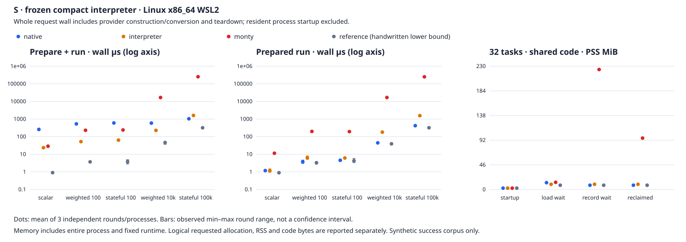

# S：冻结 compact runtime 的 WSL 实测

## 结论

本轮补齐 `969e679` 在 Linux x86_64 WSL2 上的真实请求、队列尾延迟、等待内存和 prepared-owner 成本。生产 `src/`、原有请求 harness、fixtures 和 demo 保持冻结，23 个关键文件 SHA-256 回读一致。全部可执行单元完成，旧 Pysolate 的大输入 ABI 拒绝作为缺失保留。

- 单次 cold 请求：解释器在 scalar、100 行和 weighted 10k 更便宜，分别约 23.62、52.17/63.39、226.94 µs。stateful 100k 已由 native 领先：1,036.53 对 1,600.86 µs。不能把“冷启动选解释器”推广到所有输入规模。
- 已准备的长扫描：native 的 weighted 10k / stateful 100k 为 44.43 / 420.55 µs，解释器为 180.19 / 1,557.18 µs。warm scalar 约 1.2 µs，三轮均值范围重叠，不给这一级别排胜负。
- scan mixed、两个名义 1 ms Tool 等待：cold 解释器短任务 p99 为 8.13 ms，native 为 22.69 ms；CPU/task 为 341.47 对 602.70 µs。warm 两者 p99 接近 8.3 ms，而 native CPU 更低。这里主要体现准备成本和调度粒度，并非解释器在长扫描上计算更快。
- 32 个 weighted 10k 等待任务、共享代码：record_wait PSS 为 native 7.98、解释器 9.70、common-body Monty 223.78 MiB。解释器逻辑输入 owner 已释放，但 allocator 未立即把页面还给 OS；不能用 requested bytes 代替物理密度，也不能宣称解释器在每个等待相位都低于 native。
- 普通 Python、PyPy、Pyodide 和旧 Pysolate 的版本、隔离与表示不同，各自报告生命周期。旧 Pysolate 100k 响应超过已有 1 MiB Guest Tool ABI 上限，所有包含它的 mixed 窗口都没有可比较的成功延迟。没有调高上限、分页或删掉输入来补齐成绩。

本轮不估计 N compact 改动本身的收益，不拼接旧 ARM64/macOS 数据，也不改默认 backend、调度、Provider admission 或预算语义。

审查后补充的[七点规模曲线、真实 x86_64 手写汇编参考与同运行首请求分段](wsl-frozen-extension.md)已完成。以下首轮表格/raw 不变；补充报告复用其成功点，只追加缺失形状。首轮 benchmark harness 的确切原版现存于 `bench/results/s-wsl/frozen-interpreter_ab.rs`，新增 first-request 入口不属于生产 runtime 变更。

## 环境与比较契约

- Host：`na@DESKTOP-UISID0V`，WSL2 `6.18.54.1-microsoft-standard-WSL2`，Linux x86_64；Intel i9-7920X，24 个可见逻辑 CPU，约 23 GiB RAM。各命令串行，`taskset -c 2`。未改变 Windows/WSL 内核、系统资源设置或 CPU governor，无法控制 Windows 活动与物理 SMT 竞争。
- Rust 1.96.0 / Cargo 1.96.0；Monty `56949a4c45f51cedc7a96450782f58a8017e114d`；CPython 3.12.3；PyPy 7.3.20 / Python 3.11.13；Node 24.20.0 + Pyodide 0.29.3 / Python 3.13.2。旧 Pysolate repo `bc670a757c80a023866eeac38b5eef791cd5d440`，现有 agent-core Guest 为 CPython 3.14.0，SHA-256 `ef49a628d71ab43c2523712fc47bb59ca8ebc3bfd52cfd46cbc4f493721ee8e4`。
- 五个形状：scalar、weighted 100、stateful 100、weighted 10k、stateful 100k。固定 producer：price `(i*37)%1000`、quantity `i%9-2`、limit 700、batch 17；比较同一成功输出 oracle。
- MiniPy / Monty / 普通 Python 使用 `fixtures/common_*.py` 的原样 body。Python 只套 async function wrapper。MiniPy 使用 typed 16-byte quote 行；Monty common 属性路径使用对象表示；Python/PyPy/Pyodide 使用 packed-array producer 后转 namedtuple。构造与转换成本在请求计时内。不同整数/授权/资源语义没有被统一成同一 sandbox 契约。
- `reference` 是手写 Rust fixture 的执行下界，既不解析也不编译输入，不作为一般 Python backend。Monty 本次为 common-body 属性路线，不代表应用重写成 tuple/bulk 后的最佳速度。
- 旧 Pysolate 使用公共 `Runner.Run` 和真实 Guest，fresh Guest 或 prepared-COW/data-image。适配为同步 Tools、JSON 属性对象、明确 keyword 参数，Guest 内 `SimpleNamespace` 包装；mixed 的 batch 输入编码行数以便同一 Runner 的并发 Provider 区分请求。源文件读取、JSON 构造/转换、Guest 初始化/销毁均在其请求内；Wasm compile 和 COW image capture 在单独 initialization 中。该适配单独标为 `old-pysolate-adapted`。
- cold 主表包括准备、Provider 构造、执行、转换、输出和 teardown；warm 使用已准备的代码，准备费用另列。resident Python/Pyodide 进程及 stdlib 初始化不在每请求内，单独测启动。spawn 包括每请求子进程启动、IPC 和 reap；fork 包括已有父进程上的 fork/IPC/reap，预热父进程在外。

## 重复、完整性与边界

三个独立 round/process。每形状主引擎和 CPython 41 样本丢弃前 11；PyPy 241 丢弃前 201；Pyodide 21 丢弃前 1；旧 Pysolate 支持形状 11 丢弃前 1。PyPy 只承诺这些 warmup 数量，没有证明 JIT 已达平衡。所有 warmup 原始行仍在 WSL。请求数不是独立 run 数。

Mixed 每个 round 5 个有限窗口，丢弃第一个；每窗口 40 个到达，相隔 0.5 ms，名义窗口 100 ms，inflight=40。light 权重 24/8/4/2/2，scan 权重 8/16/8/4/4。delay 0/1,000 µs，Tokio/asyncio/Go 实际 timer 误差也被量入延迟。短任务定义为 scalar 和两种 100-row 请求。

归约验证结果：690 个计划命令 = 660 完成 + 20 实际 ABI 失败 + 10 同 artifact 不支持跳过。计划 59,322 个正式请求/等待 trace 行，实得 54,456，缺失 4,866。另有 324 prepared-owner、9 process-startup、42 旧 Runner initialization 和 3 resident Pyodide initialization 行。成功输出、样本编号、mixed 权重、每窗口 CPU/wall 一致性、阶段顺序及三轮数量均检查；88 个成功形状单元、64 个 mixed 单元、184 个等待内存单元。14 类 arm 均有数据，旧 Pysolate 的两个大形状/八个 mixed 聚合单元明确缺失。

旧 Guest `guest/runtime.c:12,31` 定义 `MAX_MESSAGE=(1<<20)` 并拒绝超出的响应。保存了 20 次真实失败 stderr；识别边界后停止原 controller，跳过剩余 10 个重复不支持单元，保留已经成功的 raw。控制脚本只修正分类/resume，实际计时 worker 和二进制未改变。修正前后 hash、原脚本归档和小型 `harness-evolution.diff` 可复核；没有重跑成功 raw 以改善成绩。

CPU 为实际进程/进程树 usage，mixed 同一窗口的 CPU 只计一次再除以 40，不虚构逐请求 CPU。表中均值和三轮范围不表示置信区间；p50/p95/p99 为 nearest-rank 的池化样本分位数，窗口内请求相关。微秒级结果有计时/CPU 读数开销。

## 主请求成本

每格 wall / CPU 均值，单位 µs。完整 median、分阶段 prepare/execute/producer/conversion 和三轮值见 `summary.json`。

### Cold：准备与执行

| 形状 | native | interpreter | Monty common | reference 下界 |
|---|---:|---:|---:|---:|
| scalar | 256.87 / 258.00 | 23.62 / 24.59 | 28.67 / 29.89 | 0.91 / 1.87 |
| weighted 100 | 531.45 / 531.02 | 52.17 / 53.31 | 230.16 / 231.17 | 3.70 / 4.71 |
| stateful 100 | 598.95 / 598.80 | 63.39 / 64.66 | 239.99 / 240.92 | 3.79 / 4.76 |
| weighted 10000 | 587.68 / 587.69 | 226.94 / 227.77 | 16,674.19 / 16,648.06 | 46.41 / 48.02 |
| stateful 100000 | 1,036.53 / 1,034.52 | 1,600.86 / 1,602.00 | 252,576.80 / 252,575.68 | 319.43 / 319.54 |

### Warm：已准备代码执行

| 形状 | native | interpreter | Monty common | reference 下界 |
|---|---:|---:|---:|---:|
| scalar | 1.18 / 2.11 | 1.17 / 2.14 | 11.43 / 12.92 | 0.90 / 1.83 |
| weighted 100 | 3.72 / 4.67 | 6.32 / 7.34 | 197.79 / 198.78 | 3.31 / 4.24 |
| stateful 100 | 4.56 / 5.98 | 6.14 / 7.09 | 193.75 / 194.41 | 4.23 / 5.28 |
| weighted 10000 | 44.43 / 45.72 | 180.19 / 181.06 | 16,728.75 / 16,692.70 | 39.05 / 40.17 |
| stateful 100000 | 420.54 / 420.72 | 1,557.18 / 1,552.51 | 249,412.76 / 248,897.72 | 320.63 / 323.41 |

## 普通 Python / WASM / 旧 Guest 生命周期观察

每格请求 wall 均值，µs；resident 重新 compile body，prepared 复用 Python code object。完整 CPU 同样保存在 summary。不同隔离/版本/表示按上面的契约阅读，不做一张总性能榜。

| 生命周期 | scalar | weighted 100 | weighted 10k | stateful 100k |
|---|---:|---:|---:|---:|
| cpython-resident | 47.60 | 198.13 | 7,947.07 | 77,895.45 |
| cpython-prepared | 2.92 | 82.19 | 7,739.17 | 77,263.37 |
| cpython-spawn | 71,465.00 | 73,062.45 | 81,701.68 | 158,561.49 |
| cpython-fork | 3,669.74 | 3,869.28 | 12,997.01 | 93,537.86 |
| pypy-resident | 121.75 | 351.12 | 7,528.19 | 28,576.94 |
| pypy-prepared | 10.80 | 158.88 | 2,138.12 | 17,026.92 |
| pyodide-resident | 159.57 | 755.82 | 15,882.70 | 150,624.00 |
| pyodide-prepared | 18.45 | 685.57 | 15,475.59 | 149,976.89 |
| pysolate-fresh | 174,497.52 | 175,494.10 | 297,463.82 | ABI 不支持 |
| pysolate-cow | 2,917.35 | 6,772.32 | 136,119.50 | ABI 不支持 |

启动不是免费的：新 CPython process + imports + scalar/IPC/reap 中位数 73.71 ms（三次 72.89–78.34）；新 PyPy 为 144.63 ms（140.54–316.74）；新 Node + Pyodide/Wasm/stdlib/harness/reap 为 2,191.18 ms（2,160.66–2,194.86）。旧 Runner artifact read + Wasm compile 的均值约 6,734.80 ms，COW capture 路线约 6,996.55 ms，进程启动和 Go imports 仍在外。启动边界不同，不能把这些数字当作同一 request 排名。

## Mixed 队列尾延迟

scan、名义 1 ms Tool delay；每单元保留 12 个窗口 × 40 请求。p50/95/99 为短请求延迟，单位 ms；CPU 为窗口 CPU/task，µs。

| 引擎 / 生命周期 | CPU/task µs | short p50 ms | p95 ms | p99 ms | finite req/s | 过载窗口/12 |
|---|---:|---:|---:|---:|---:|---:|
| native cold | 602.70 | 11.50 | 20.85 | 22.69 | 400.00 | 0 |
| interpreter cold | 341.47 | 5.02 | 6.94 | 8.13 | 400.00 | 0 |
| monty cold | 34,957.53 | 1,264.46 | 1,434.35 | 1,455.01 | 28.65 | 12 |
| reference cold | 160.95 | 5.07 | 6.90 | 8.12 | 400.00 | 0 |
| native warm | 184.04 | 5.25 | 7.37 | 8.25 | 400.00 | 0 |
| interpreter warm | 296.77 | 4.91 | 7.03 | 8.29 | 400.00 | 0 |
| monty warm | 35,956.52 | 1,311.15 | 1,450.00 | 1,470.18 | 27.70 | 12 |
| reference warm | 171.85 | 5.31 | 7.62 | 8.69 | 400.00 | 0 |

ordinary 路线的同输入有限窗口，仍各自保留 resident/prepared/fork/spawn 边界：

| 生命周期 | CPU/task µs | short p99 ms | finite req/s | 过载/12 |
|---|---:|---:|---:|---:|
| cpython-resident | 10,604.79 | 422.53 | 93.70 | 12 |
| cpython-prepared | 10,481.04 | 419.13 | 94.98 | 12 |
| cpython-spawn | 99,329.17 | 3,798.34 | 10.07 | 12 |
| cpython-fork | 14,587.81 | 289.10 | 68.15 | 12 |
| pypy-resident | 4,002.54 | 161.51 | 246.87 | 12 |
| pypy-prepared | 2,764.09 | 121.13 | 357.13 | 12 |
| pyodide-resident | 18,598.47 | 770.28 | 53.40 | 12 |
| pyodide-prepared | 18,111.67 | 754.09 | 55.65 | 12 |

旧 Pysolate mixed 的 100k Tool 返回失败，没有成功整窗的 CPU/尾延迟；不拿部分请求或小输入替换它。finite throughput 以 `40 / max(100ms, drain wall)` 定义：400 req/s 是计划窗口上限，不能解释为引擎饱和容量。重型 ordinary/Monty 的过载仅描述本合成 burst，不能外推一般服务。

## 等待内存：requested、RSS、PSS 分开

主表为 32 个 weighted 10k、共享 code owner，三次独立 process 均值。PSS/RSS 为整个进程的 MiB，requested 为 Rust allocator 记录的 live requested KiB；不含 OS 页表/内核服务 RAM，不扣除固定 runtime。

| 引擎 | startup PSS | load_wait PSS | record_wait PSS | reclaimed PSS | record_wait RSS | record_wait requested KiB |
|---|---:|---:|---:|---:|---:|---:|
| native | 2.51 | 12.73 | 7.98 | 7.98 | 9.97 | 103.22 |
| interpreter | 2.50 | 9.70 | 9.70 | 9.70 | 11.70 | 70.82 |
| monty | 2.49 | 13.35 | 223.78 | 95.90 | 225.62 | 182,675.75 |
| reference | 2.53 | 7.96 | 7.96 | 7.96 | 9.80 | 57.49 |

32 份 typed 输入 payload 为 5,120,000 bytes，仅是 load_wait 的一部分。native/interpreter/reference 的 record_wait 不再拥有该输入 buffer；PSS 仍可能因 allocator arenas 而保留。Monty common 属性对象保留在执行上下文，record_wait 的 logical/requested 与物理 PSS 都明显增加。reclaimed 表示任务/owner 已结束并按 harness 做清理，不承诺 OS 已回收全部页面。CPython/PyPy 内存路径会显式 GC，旧 Go 路径只关闭完成的 Guest，不强制 GC。

ordinary 物理观察（same-body resident 32 tasks，isolated-tree/Pyodide 为既有 tuple-secondary、8 tasks，旧 Guest 为 adapted、32 tasks），不直接归一成 KiB/task 排名：

| 路线 / task 数 / 表示 | startup PSS MiB | load_wait | record_wait | reclaimed | record RSS MiB | requested |
|---|---:|---:|---:|---:|---:|---|
| cpython-resident / 32 / common | 13.27 | 18.60 | 101.52 | 74.77 | 109.33 | tracemalloc，非同口径 |
| pypy-resident / 32 / common | 79.66 | 85.27 | 115.20 | 83.74 | 117.56 | 未测，非 0 |
| cpython-spawn / 8 / tuple-secondary/tree | 13.99 | 113.89 | 121.27 | 14.07 | 204.76 | 未测，非 0 |
| cpython-fork / 8 / tuple-secondary/tree | 13.98 | 34.24 | 48.89 | 14.06 | 170.68 | 未测，非 0 |
| pyodide-resident / 8 / tuple-secondary | 162.96 | 164.38 | 172.85 | 169.46 | 176.50 | tracemalloc，非同口径 |
| pysolate-fresh / 32 / adapted | 372.89 | 1,200.56 | 1,293.78 | 1,293.85 | 1,295.25 | 未测，非 0 |
| pysolate-cow / 32 / adapted | 396.80 | 539.06 | 656.08 | 521.31 | 742.76 | 未测，非 0 |

Fork 的树 RSS 会重复计算共享页，必须同时看 PSS。PyPy 无可用 tracemalloc，Go/isolated-tree 没有 requested allocation 测量；空值保持 null。Pyodide 的 tracer 不覆盖整个 Node/WASM 进程，不能代替其 process PSS。COW 对 old Guest 的等待 PSS 有实际收益，但 fixed runtime 和响应 ABI 上限仍存在。

## Prepared owner 留存成本

单独 counting-allocator binary，只准备/持有/释放 code owner，不执行请求。每种形状分别测 1/32 个 owner、unique/shared、3 个新 process。whole-process 包括编译器保留 scratch；逻辑 interpreter unit bytes 与 native machine-code bytes 的定义不同，不能直接当作总 RAM。

| 形状 | interpreter logical bytes | native machine-code bytes | interpreter 32 unique PSS MiB | native 32 unique PSS MiB | Monty 32 unique PSS MiB |
|---|---:|---:|---:|---:|---:|
| scalar | 594 | 312 | 3.06 | 6.19 | 2.98 |
| weighted | 1090 | 752 | 3.21 | 6.37 | 3.17 |
| stateful | 1114 | 848 | 3.20 | 6.39 | 3.20 |

weighted 额外 31 个 owner 的 requested 差值除以 31：interpreter 1.08 KiB/owner；native 5.98；Monty 14.54。这是批量 diagnostic 的 Rust requested ownership 增量，含 Rc/容器/内部结构，排除 OS mapping 页粒度，不是普通请求物理内存斜率。独立 process 的小 PSS 差值会受 allocator 页粒度影响；scalar unique 甚至略低于 shared，不能把那种差值解释为真实节省。

## 验证、存储与复现

实际 WSL `cargo +1.96.0 test --offline --locked --features fixture-reference`：66 tests pass，包括 14 interpreter 回归和真实 native/script acceptance。新 harness 5 个 invariant tests 在 CPython/PyPy 各通过，覆盖 common wrapper/oracle/Tool 次数、等待阶段、CPU 每窗口一次、nearest-rank、缺失不零填与完整计划扩展。真实成功 cells 中的 stdout/Tool 次数由 worker 验证。SVG 已完整 browser 渲染检查；误差棒明确为三轮 min/max，不画虚构置信区间。

WSL task root `/home/na/benchmarks/minipy-s`：raw JSONL(gz)、targets、PyPy/Pyodide、依赖 cache/source 都保留在那里。task tree 约 2.49 GB，其中 raw JSONL 合计约 1.57 MB。Mac/Git 只保留本报告、plan、23-file source hashes、identity/verification、607,611-byte summary 和小 SVG；没有 raw、target、下载 runtime 或 CI workflow。原始数据当前依赖这台 WSL 的持久磁盘，未上传独立归档。

源与命令：

1. 在 WSL 建 task-local `source`，runtime source 对齐 `969e679`，保留本次 `tools/s_wsl_*`、`bench/src/bin/s_prepared.rs` 和 `bench/results/s-wsl/{plan,frozen-source,abi-limit}.json`。当前 evidence source 的 runtime/fixtures 与 frozen hashes 一致；原 harness 归档 `frozen-interpreter_ab.rs` 也保留确切原 SHA。构建首轮 binary 前暂存当前 `interpreter_ab.rs` 并将归档 copy 回其原路径，完成后恢复新增 first-request 入口，详见补充报告复现步骤。
2. `cargo +1.96.0 build --release --locked --manifest-path bench/Cargo.toml --bin interpreter_ab`，copy 为 task root `speed`。再用 `--features allocation-diagnostics --bin interpreter_ab --bin s_prepared` 构建，分别 copy 为 `memory` / `prepared`。实际本轮依赖曾遇到网络停滞，复用了已缓存的 exact Monty Git bundle 和 lock 对应 crate，缺失 crate 在 WSL 下载；之后带 `--offline` 构建。没有在 Mac 构建执行目标。
3. task-local PyPy 官方 `pypy3.11-v7.3.20-linux64.tar.bz2` SHA-256 为 `1410db3a7ae47603e2b7cbfd7ff6390b891b2e041c9eb4f1599f333677bccb3e`。Pyodide `npm install --no-audit --no-fund pyodide@0.29.3` 在 task-local runtime。Node path、PyPy path、Guest path 与所有动态库/stdlib hashes 见 identity；不要修改原 Pysolate repo。
4. old harness 在 task-local `old-harness`：copy `s_wsl_pysolate.go` 为 `main.go`；`go mod init example.com/minipy-s`，`go mod edit -require=github.com/bkmashiro/agent-python-runtime@v0.0.0 -replace=github.com/bkmashiro/agent-python-runtime=/home/na/projects/agent-python-runtime`，copy 既有 `go.sum`，`GOPROXY=off go mod tidy` / `go build -o ../pysolate-bench .`。既有 Guest/依赖是前提，不把 artifact 缺失视为可跑。
5. 从 source：`python3 tools/s_wsl_campaign.py ../plan.json ../results`，完成后串行 `python3 tools/s_wsl_secondary.py ../results`。原 plan 与 commands 不变；已有 raw 只复核后复用。`abi-limit.json` 只对匹配 Guest hash 的已知形状跳过；新 campaign 可能全跳过 30 个已知不支持命令，不能把历史失败重算为新实测。
6. `python3 tools/s_wsl_summary.py ../results ../plan.json`、`python3 tools/s_wsl_plot.py ../results/summary.json ../results/overview.svg`。summary 拒绝额外失败、缺 row/round、CPU 不一致、source hash 漂移，不合成缺失数据。full tests 后记录 toolchain、postflight、raw 与 binary hashes；下载的小型 deliverables 六个 SHA 已与 WSL 回读逐一一致。

## 可用结论与剩余范围

冻结轻量解释器是这组低复用、小/中等输入的低准备成本路线。native 在可复用长 scan 与本次 100k cold 已有端到端优势；继续保持显式选择，任务没有授权实现自动 backend/cache。普通 Python 的 broader semantics、安全边界与 provider 表示成本是重要上下文，不能把成功合成 corpus 的倍率变成一般 Python 速度或安全隔离结论。

当前证据覆盖固定成功输入、三轮单逻辑 CPU WSL 运行与有限 burst；不覆盖 adversarial sandbox、长稳态开放流量、provider 全局 admission、实际 agent 网络/数据库、paged old Guest 或 Windows 原生部署。原有 chunk-per-scan 与 detached Provider 无全局 admission 限制仍按 N 文档成立，未修复也未扩大。
