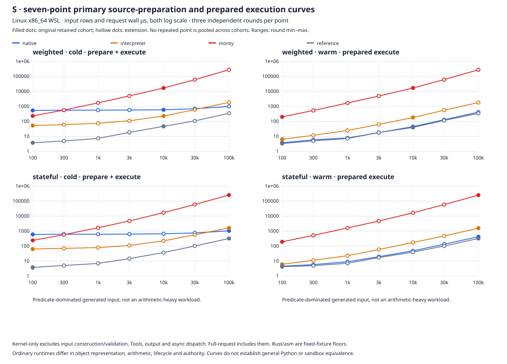
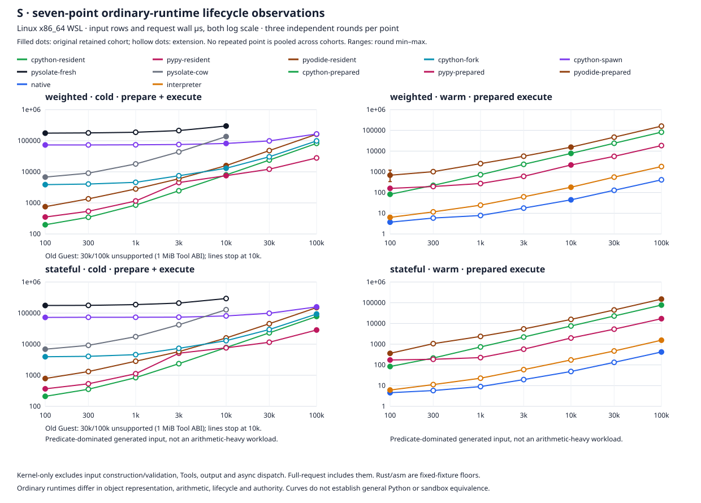
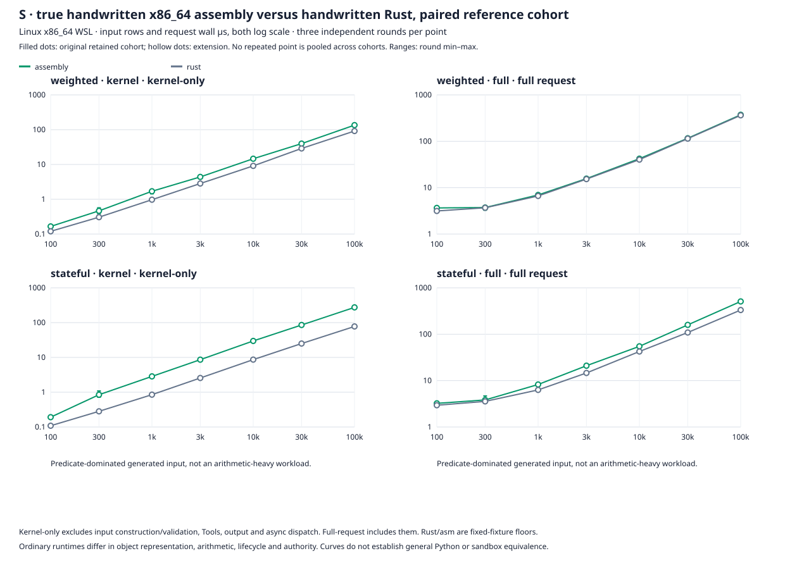
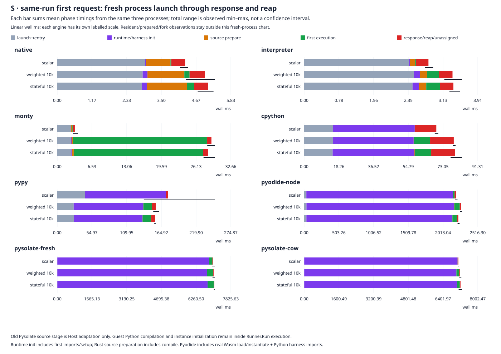

# S 补充：规模曲线、x86_64 参考与同运行首请求分段

## 结论

本轮补齐首轮审查的三个实测缺口。生产 runtime、Provider、资源与权限语义、common fixtures 和 demo 均未改动。原有五个成功形状及其 raw 继续使用，新增十个缺失形状、独立参考对照和首请求观测，没有重跑原主表以改善成绩。

- weighted 和 stateful 的 cold 均值在 30k 仍由解释器领先，100k 已由 native 领先。两种输入只能给出实测交叉区间 30k–100k，不能推导精确自动切换阈值。warm 七点的 native 均值都较低，小输入的三轮范围有重叠。
- 真正执行了 115-byte 手写 x86_64 scan，checked signed multiply/add 直接由 `imul` / `add` / `jo` 完成，无 Rust 算术 helper 调用。它在这组输入上没有超过 Rust；weighted 100k kernel 为 asm 135.25 / Rust 91.58 µs，全请求为 372.51 / 362.91 µs。stateful 的差距更大。固定参考用于定位成本，不能称作架构最优或未知源程序 backend。
- fresh scalar 首请求均值为解释器 2.80 ms、native 4.30 ms、Monty 3.29 ms。真正首次 source prepare 比 resident cold 主表中的准备更贵。启动、初始化、准备、执行与 response/reap 均取自同一个新进程，逐行与总 wall 精确相加；图中没有拼接不同实验的中位数。
- 旧 Guest 30k / 100k 仍受冻结的 1 MiB Tool response ABI 限制。支持点止于 10k。COW 的请求复用优势没有消除首次 Wasm compile / image capture 成本。

这些观察支持保留显式 backend 选择。此次没有实现自动路由、cache、admission、paging 或新编译优化。

## 规模与比较契约

沿用[首轮报告](wsl-frozen-benchmark.md)的 i9-7920X、x86_64 WSL2、CPU 2、串行执行、工具链与依赖。每个点分别保留三个独立 process round，不把同一进程内的几十个请求当作独立样本。weighted / stateful 为 N=100、300、1000、3000、10000、30000、100000；scalar 的原五形状结果保留在原主表，并加入新首请求观测。

common body、price `(i*37)%1000`、quantity `i%9-2`、limit 700、batch 17 和输出 oracle 不变。MiniPy / Monty 使用原样 body；ordinary Python / PyPy / Pyodide 只套 async wrapper。Monty 是 common 属性对象路线，未宣称它代表 tuple/bulk 重写后的最佳 Monty。普通 Python 的整数、对象、版本、authority 和隔离契约仍与 MiniPy 不同。

新增形状继续使用原 `speed` / `pysolate-bench` 二进制，hash 与原 identity 一致。主引擎/CPython 41 样本丢前 11、PyPy 241 丢前 201、Pyodide 21 丢前 1、旧 Guest 11 丢前 1。PyPy warmup 数量不构成 JIT 收敛证明。原成功点和新增点不重复、不池化，图中实心点为 original，空心点为 extension；两批同机观测的时间差仍可能带来环境差异。

### 主引擎七点曲线

每格为三个 round 请求 wall 均值的均值，单位 µs。cold 包括 source prepare、Provider 构造、输入生成/转换、Tools、输出、任务与本请求 owner 的 teardown。warm 不含 code preparation。所有 round 值、median、CPU 与阶段数据在 `extension-summary.json`。

### weighted

| N | cold native | cold interpreter | warm native | warm interpreter | point cohort |
|---:|---:|---:|---:|---:|---|
| 100 | 531.45 | 52.17 | 3.72 | 6.32 | original |
| 300 | 553.27 | 60.15 | 5.88 | 11.66 | extension |
| 1000 | 559.13 | 74.66 | 7.80 | 24.63 | extension |
| 3000 | 566.55 | 109.15 | 17.72 | 62.17 | extension |
| 10000 | 587.68 | 226.94 | 44.43 | 180.19 | original |
| 30000 | 689.30 | 599.78 | 128.28 | 554.72 | extension |
| 100000 | 984.40 | 1844.27 | 410.60 | 1793.90 | extension |

### stateful

| N | cold native | cold interpreter | warm native | warm interpreter | point cohort |
|---:|---:|---:|---:|---:|---|
| 100 | 598.95 | 63.39 | 4.56 | 6.14 | original |
| 300 | 620.01 | 71.06 | 5.80 | 11.24 | extension |
| 1000 | 614.66 | 78.90 | 9.02 | 22.83 | extension |
| 3000 | 625.39 | 109.98 | 19.57 | 59.16 | extension |
| 10000 | 662.24 | 221.87 | 48.17 | 173.74 | extension |
| 30000 | 748.56 | 563.72 | 133.14 | 470.36 | extension |
| 100000 | 1036.53 | 1600.86 | 420.54 | 1557.18 | original |

两条 cold 曲线的采样交叉区间都是 30k–100k。曲线连线仅帮助阅读采样点，不是连续预测模型。stateful 的既定分布会逐步提高 previous，让后续大部分行在 predicate 上被排除；这组结果主要体现扫描、predicate、状态与调度成本，不能概括为大量乘加 workload。

### Ordinary 生命周期曲线

resident 重新 compile，prepared 复用 code object；spawn 包含新 CPython child/IPC/reap，fork 复用已初始化父进程再 fork。Node / Pyodide resident excludes Node/Wasm/stdlib 初始化，旧 Runner 的 Wasm compile / COW image capture 也在单请求曲线外。左图保持这些标注，不能跨隔离路线用一个倍率给出统一性能榜。

旧 `guest/runtime.c:12,31` 的 `MAX_MESSAGE=(1<<20)` 未改动。新 controller 按相同 compact JSON row 字段与格式计算响应 bytes，30k / 100k 都超过该 bound，18 个新命令在执行前明确分类 unsupported。此处是冻结 artifact/source 边界推导，沿用首轮实际 100k 拒绝证据；没有伪装成新测失败，没有将缺失填为 0，也没有换成分页输入。支持的 N≤10k 请求全部实际运行。

## x86_64 手写汇编参考

`bench/src/weighted_x86_64.S` 为两个固定成功 scanner 编写 SysV ABI machine-code，weighted / stateful 入口共 115 bytes。借用 Quote slice 保证行区域的空间/生命周期有效，编译期检查 16-byte layout 和两个字段 offset。quantity、limit、previous 按原短路顺序检查，signed multiply/add 溢出返回 task error。没有栈分配、syscall、Rust 回调或不可信 code injection。实际 ELF disassembly 见 `x86-disassembly.txt`。

本参考只绑定冻结的 weighted / stateful 成功程序，scalar 继续由原手写 Rust fixture 表与新首请求表报告。未增加一般源执行接口或将编译器输出冒充手写汇编。保留 AArch64 参考，但本轮只实测 x86_64 Linux。

最终验证追加了 compile-time exact byte assertion，fixture 改动会拒绝继续使用旧手写 kernel。确切 measured harness 另存 `measured-assembly_ab.rs`；追加断言后的全 ELF hash 不同，但 `objcopy` 提取的完整 `.text` 与原实测 binary 逐字节一致（共同 SHA `24911366c36aaac77580341ef2bf678c67fa722cab22ba35df82010befdf2697`），没有新增执行工作。保留原全部观测，不把新 ELF hash 写成原实测 hash。相同断言在 task-local fixture 副本上实际接受原 body、拒绝注释改动后的 body，生产 fixture 未动；新增 build/tests、两个 source/ELF hash 见 `extension-verification.json`。

一次 objcopy dump 因没有指定独立输出 ELF 改写了输入 artifact metadata，严格归约立即拒绝其 hash。由确切 measured source 重新构建，完整原 ELF SHA 逐字节重现；修正 dump 使用独立输出，两个输入 hash 与全部 raw 保持一致。没有重跑或替换性能观测，最终 extension summary SHA 不变。复现应使用 verification 中的修正命令。

- kernel-only：预生成/验证 typed rows 在计时外；每请求重置 total/previous，计入真实 kernel 调用及 checked scan，不含 input producer、Tools、stdout、async dispatch、任务权限或资源检查。直接 kernel 可以扫描完整借用 slice，不能代替全请求 task API。
- full-request：按同一个 RequestProvider、chunk 256、真实 load/record detached wait、输入生成/验证、budget/cancellation、checked receipt/stdout、owner 释放和异步 yield 执行。Rust 使用既有 `fixture_reference::execute`，asm 使用既有 benchmark-only host wrapper，扩展到 x86_64；这两个 wrapper 并非完全逐指令相同。权限、fuel、buffer、Tool 次数与 output 边界未删除。
- 每 arm / shape / boundary 3 个 process round，每 process 41 次丢前 11。arm 顺序按 round 反转；不与原主表的 Rust reference 点混池。

单位 µs，以下六个代表点展示三轮 wall 均值。全部七点见图与 JSON。

| shape | Rust kernel | asm kernel | Rust full | asm full |
|---|---:|---:|---:|---:|
| weighted 100 | 0.120 | 0.166 | 3.147 | 3.656 |
| weighted 10000 | 9.112 | 14.634 | 40.272 | 42.155 |
| weighted 100000 | 91.584 | 135.250 | 362.909 | 372.509 |
| stateful 100 | 0.109 | 0.191 | 2.944 | 3.233 |
| stateful 10000 | 8.638 | 29.747 | 42.412 | 54.810 |
| stateful 100000 | 77.676 | 274.473 | 332.272 | 508.721 |

手写 asm 的较小 instruction body 没有转化为本轮更快的执行。尤其 stateful predicate-heavy 分布，Rust 的优化结果更快。本任务没有为赢 benchmark 而继续改 asm、移走输入构造、忽略溢出或换掉 body；当前证据足以否定“手写 asm 必定更快”的假设。kernel 与 full 的差值也不是严格成本分解：两个 boundary 的 cache、调度和计时条件不同，不将其差值冒充某个单独 stage 的实测。

## 同一次新进程的首请求分段

8 条 runtime 路线 × scalar / weighted 10k / stateful 10k × 3 个新 process，共 72 次首请求；没有 warmup 或 prepare probe。Linux 共享 CLOCK_MONOTONIC：controller 在 launch 前与 response/reap 后取点，child 在 entry、runtime/harness ready、prepared、executed 后取点。Rust 首请求分支在原先用于诊断 prepared bytes 的额外 preparation 之前返回。

五个连续 phase 每条 raw 都检查顺序、非负、与同次总 wall 的精确 ns 求和。图中 stack 是这三个 process 各 stage 的算术均值，故仍与 total mean 相加；黑线仅是总 wall 的三次观测 min/max。summary 另外保留 total median，不把 phase medians 相加。总 CPU 是 controller SELF + reaped CHILDREN 的真实 usage，没有伪造 stage CPU。

下表为 scalar，所有值单位 ms。source preparation、首次执行和进程退出的 code/runtime 清理按实际切点归属，不从 resident/prepared/spawn/fork 表推导。

| engine | launch→entry | runtime/harness init | source prepare | first execution | response/reap/unassigned | total mean | observed total range |
|---|---:|---:|---:|---:|---:|---:|---|
| native | 2.951 | 0.031 | 0.824 | 0.026 | 0.464 | 4.296 | 4.125–4.390 |
| interpreter | 2.355 | 0.022 | 0.124 | 0.013 | 0.284 | 2.799 | 2.717–2.903 |
| monty | 2.586 | 0.027 | 0.228 | 0.106 | 0.348 | 3.295 | 2.953–3.895 |
| cpython | 15.185 | 42.965 | 0.094 | 0.081 | 11.195 | 69.520 | 68.688–70.578 |
| pypy | 43.814 | 128.141 | 0.088 | 0.220 | 3.082 | 175.345 | 137.084–249.883 |
| pyodide-node | 32.035 | 2121.304 | 5.198 | 22.068 | 21.317 | 2201.921 | 2187.869–2223.036 |
| pysolate-fresh | 4.531 | 6836.854 | 0.038 | 155.773 | 21.463 | 7018.659 | 6977.760–7099.128 |
| pysolate-cow | 4.449 | 7066.601 | 0.035 | 3.535 | 35.650 | 7110.269 | 7096.179–7122.871 |

阶段的可观察性边界：

- launch→entry 包含 `taskset`、OS 进程启动、动态 loader 和进入可取点位置前的 runtime 工作。CPython / PyPy 首次 `import time` 前的初始化在此，之后的大部分 stdlib/harness import 在 runtime/harness init。不能把这列当作纯 OS spawn 时间。
- Rust runtime/harness init 包括 source 读取、expected 初始化和 Tokio 构造；source prepare 是实际 parse/lower/compile，execute 含 Provider 与 generated input、Tools、stdout 和请求 owner reclamation。
- Python source prepare 是 common async wrapper compile；execute 含 function scope、input conversion、Tools、输出和 scope cleanup。code object/runtime 在退出时的清理仍计入最后一段。
- Node / Pyodide runtime/harness init 包含 dynamic module load、真实 Wasm compile/load/instantiate、Python/stdlib 初始化与 benchmark imports。source compile 和 first execute 另取 JS hrtime 切点，包含对应小桥接费用。
- old Pysolate init 包含 Runner 的 Guest artifact read / Wasm compile，COW arm 还包括 prepared image capture。source stage仅是 Host source adaptation；公开 `Runner.Run` 不暴露内部 Guest Python compile / fresh instance init 的独立切点，二者保留在 execute，未靠其他实验相减编造拆分。
- response/reap/unassigned 包括输出 oracle 验证、JSON 编码/pipe、残余 code/runtime 清理和退出/reap。它没有被悄悄分摊到执行或删除。timer/debug/benchmark harness 自身的小成本保留在对应 boundary 中。

resident / warm-prepared / preinitialized-parent fork 的原结果继续单独展示。将这张 fresh-process 图拿去推算常驻服务吞吐，或把 COW 的首次初始化计作每次请求，都会换掉生命周期契约。

## 完整性、验证与存储

扩展计划 780 命令 = 762 completed + 18 unsupported，无其他失败。计划 38,100 正式 request trace 行（含保留 warmup），实得 37,902，unsupported 198；另外有旧 Runner 的 initialization metadata 行，不混入该 request 行数。curve 新增 174 个成功聚合单元，与原 88 个成功单元合为 262（包含 scalar；两种 30k/100k × 两旧 Guest arm 的 8 个缺口保持缺失）。reference 56 个单元，first-request 24 个单元，各自恰好三个独立 round。

实测验证：

- WSL `cargo +1.96.0 test --offline --locked --manifest-path bench/Cargo.toml --bin assembly_ab`：5 tests pass，包含 signed overflow / predicate short circuit / 跨 chunks / empty slices 的差分、full permission/fuel/cancellation/late effect、Provider error/output bounds/owner 在 record 前释放，以及 existing common/Monty 测试。
- 新 extension harness tests：CPython / PyPy 各 4 pass，覆盖计划总数、不得重复 original 成功 cell、same-run phase 求和、missing/negative/duplicate sample 拒绝与真实 common 首请求 oracle。原 harness 全部 6 tests pass。
- 534 个原 raw 文件 hash/size 回读全部一致，原 `speed` / `pysolate-bench` hash 保持一致。原 reducer 再运行后 `summary.json` 字节 hash 不变。新增 762 个 raw 文件、所有 phase identities 的源/二进制/Guest/runtime hash 在 postflight 回读一致。
- 生产与 fixture/manifests 的 22 个冻结文件完全一致；为新首请求入口改动的 benchmark harness 原版单独归档为 `frozen-interpreter_ab.rs`，验证仍保留其原 SHA，不把新 harness 冒充原 source。原归约脚本只改为验证这个确切归档，核心 runtime 验证未放宽。
- 四个 SVG 全幅 Chrome 实际渲染检查通过，log axis 使用真实 N，缺失点不连成虚构分数，range 是三个 round 的观察范围。没有装 chart dependency 或在 Mac 构建。

Raw / build / runtime 都留在 `/home/na/benchmarks/minipy-s`。新 extension 目录约 5.0 MiB；Mac/Git 保留报告、命令与 status、summary、source/identity/test/verification、四个小 SVG，不携带 raw、target、下载 runtime 或 credentials。依赖原始数据的长期可用性仍受这台 WSL 磁盘保留影响。

## 复现

在同 host 的 task-local source 使用当前 evidence source。runtime / fixtures 来自冻结 `969e679`，旧 Guest/runtime/toolchains 版本见首轮 identity。保持原数据目录不改，extension 使用不同目录，runner 对已存在 raw 只校验复用。

1. 原 `speed` / `pysolate-bench` 已留存并验 hash。新复现时，先暂存当前 `bench/src/bin/interpreter_ab.rs`，将 `bench/results/s-wsl/frozen-interpreter_ab.rs` copy 回该路径，按首轮命令构建原 speed/memory/prepared；再恢复当前 harness。原 Go benchmark 用原 evidence commit 的 `s_wsl_pysolate.go` 构建，不能用扩展 binary 冒充历史 binary。
2. 当前 source：`cargo +1.96.0 build --offline --locked --release --manifest-path bench/Cargo.toml --bin assembly_ab --bin interpreter_ab`，copy 为 task root `assembly-extension` / `speed-extension`。新 Go first-request worker copy 到 task-local old-harness，`gofmt -w main.go; go build -o ../pysolate-extension .`，沿用 original Go module/Guest。
3. 从 source 串行运行 `python3 tools/s_wsl_extension.py first ../extension`、`... reference ../extension`、`... curve ../extension`。curve 自动跳过原五个成功形状，只补缺失形状；原 summary 是前提，不能用不存在的原数据声称完整曲线。
4. `python3 tools/s_wsl_extension_summary.py ../extension ../results/summary.json ../extension`；`python3 tools/s_wsl_extension_plot.py ../extension/extension-summary.json ../extension`。归约拒绝其他失败、缺 sample/round、repeat original cell 与 phase 和漂移。
5. 对照 `bench/results/s-wsl/{curve,reference,first}-commands.json` 与相应 identity。`extension-raw-identity.json` 对 762 个新增 raw 给出 exact hash/bytes；`extension-verification.json` 记录原始文件保护、工具链、测试和 postflight；test logs 与 x86 disassembly 一并保留。

本轮没有改变 chunk/fuel、detached Provider、权能、安全边界、native CodeUnit 的一般源执行路径或 demo，也没有加入 CI、自动 cache 或新的 metadata framework。WSL 单 host、有限 synthetic success corpus、Windows/SMT 干扰与三轮精度限制仍成立。
